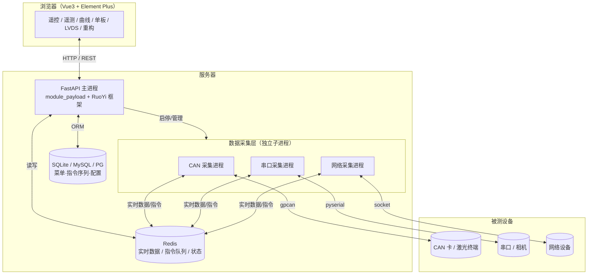
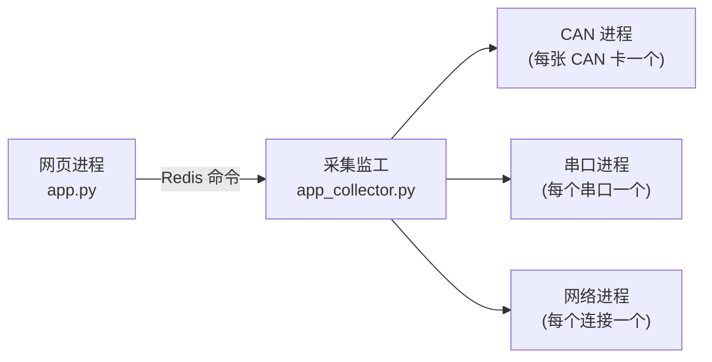
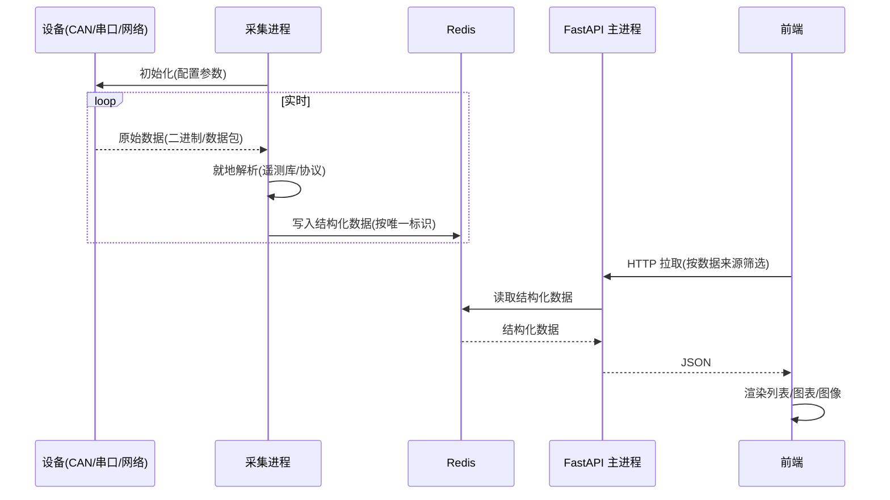
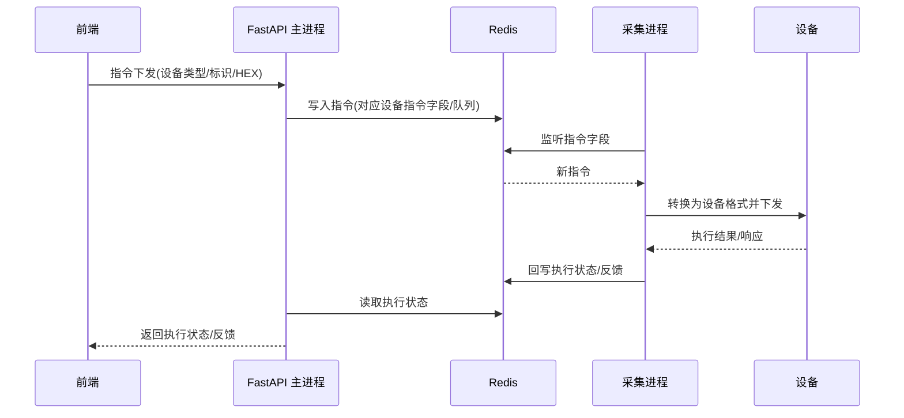

# 01 - 系统总体设计

## 1. 设计目标

通过浏览器端可视化界面，实现对卫星激光终端的：

- **实时数据监控**：CAN 遥测、工程遥测（LVDS/高速）、串口图像等多源数据实时展示；
- **指令控制**：遥控指令下发、控制开关操作、指令序列批量执行；
- **图表分析**：遥测量曲线、工程遥测高速波形（类示波器）；
- **图像状态展示**：相机串口图像采集与显示。

后端采用 **多进程架构**，把「设备采集」与「API 服务」解耦，保证采集稳定性不受 Web 请求波动影响。

---

## 2. 总体架构



### 分层职责

| 层             | 角色                | 关键职责                                                                 |
| -------------- | ------------------- | ------------------------------------------------------------------------ |
| 前端展示层     | Vue3 SPA            | 菜单路由、表单、表格、ECharts 图表、指令面板                              |
| API 服务层     | FastAPI 主进程      | 鉴权、菜单、CRUD、把前端请求翻译为 Redis 读写；开关设备改为向监工发命令 |
| 进程间通信     | Redis               | 采集进程与主进程之间的实时数据、指令、状态、心跳交换                      |
| 数据采集层     | CAN/串口/网络子进程 | 设备初始化、原始数据读取、**就地解析**、指令执行、断线重连               |
| 持久化层       | SQLite/MySQL/PG     | 系统菜单、指令序列、（可选）遥测历史                                     |

> **为什么用 Redis 而非进程内队列**：采集进程是独立操作系统进程（非线程），与 FastAPI
> 进程不共享内存；Redis 提供了进程间共享的数据总线，并天然支持多 worker 部署。

---

## 3. 进程模型

### 3.1 进程划分



两种启动方式，监工逻辑都是 `module_payload/collectors/supervisor.py` 的 `serve()`：

| 方式 | 启动 | 说明 |
| ---- | ---- | ---- |
| 独立监工 | `python app_collector.py [--env=…] [--host 标识]` | 与 `app.py` 同级，打进同一个 wheel。不传 `--env` 时用 `.env.prod`。`--host` 覆盖 `COLLECTOR_HOST`，不传则沿用环境变量、配置，最后是 `local`。Ctrl+C 停掉本监工拉起的采集进程 |
| 嵌进后端 | `COLLECTOR_EMBEDDED=true` 后只跑 `python app.py` | 后端启动时把同一段 `serve()` 拉成子进程，退出时先让监工停采集再结束监工 |

网页进程不打开 CAN / 串口 / 网口。打开、关闭经 Redis 命令交给当前 `COLLECTOR_HOST` 对应的监工；硬件清单（串口、CAN 厂商、本机地址）由监工扫描后写入快照。同一安装包用不同 `--host` 可以同时跑多份监工。

- 采集子进程：监工用 `subprocess` 启动 `runner.py`，每类设备一套采集逻辑，独立崩溃不影响其它设备与网页。

### 3.2 进程粒度与生命周期（关键规则）

> 详见 [02-数据采集层设计](./02-数据采集层设计.md)。

- **CAN 卡（进程级共享）**：`--vendor`、`--dev-index` 相同、`--can-index` 不同表示
  **同一张 CAN 卡的不同通道**。同一张卡的所有通道**共用同一个进程**；只有当该卡上
  所有通道都关闭后，才能关闭对应进程。
  - 通过 `CanClient.get_opened_channel_list()` 获取某厂家驱动下已打开的通道列表辅助管理。
- **串口 / UDP（按需启停）**：打开即开启进程，关闭即关闭进程。
- **唯一标识**：从 Redis 取数时需要设备唯一标识（见 [02 章 Redis Key 设计](./02-数据采集层设计.md)）。

---

## 4. 数据流

### 4.1 采集 → 前端展示



### 4.2 前端指令 → 设备执行



---

## 5. 技术选型

| 维度       | 选型                                          | 说明                                            |
| ---------- | --------------------------------------------- | ----------------------------------------------- |
| 后端框架   | FastAPI（RuoYi-FastAPI 脚手架）               | 异步、自动路由注册、分层（controller/service/dao） |
| ORM        | SQLAlchemy（async）                           | DO 模型继承 `config.database.Base`              |
| 数据库     | MySQL（`.env.dev` 默认）；SQLite（`.env.sqlite`，首次导入后生成 `ruoyi-fastapi.db`）；PostgreSQL | 同时维护 MySQL / PG / SQLite 三套 SQL（`sql/`） |
| 缓存/总线  | Redis 7.x（`redis==7.1.0` 已在依赖）          | 实时数据、指令队列、采集状态                     |
| 前端框架   | Vue 3.5 + Vite 6 + Element Plus               | 动态路由由后端 `sys_menu` 驱动                   |
| 图表       | ECharts 5.6（已在依赖）                       | 遥测曲线、工程遥测波形                           |
| 进程       | `app_collector.py` 监工 + `subprocess` 工作进程 | 采集与网页分开部署，经 Redis 交互               |
| CAN        | `gpcan` 1.0.5（`dist/pkg/`）                  | 参考本地 `test/pygpcan`（未入库）               |
| 遥测解析   | `telemetryparser` 1.0.1（`dist/pkg/`）       | 参考本地 `test/TeleMetry`（未入库）             |
| 串口       | `pyserial`                                    | 相机图像采集（见 `test/showimg`）               |

> **依赖说明**：`pyserial==3.5` 已在 `requirements.txt`；`gpcan`、`telemetryparser` 不在 PyPI，
> wheel 位于 `dist/pkg/`，需单独 `pip install`（见根目录 `README.md`）。

---

## 6. 新增代码目录规划

### 6.1 后端（`ruoyi-fastapi-backend`）

```
app.py                          # 网页入口
app_collector.py                # 独立监工入口（与 app.py 同级，打进同一个 wheel）
module_payload/                 # 载荷地检业务模块
├── controller/                 # 路由层
│   ├── device_controller.py        # 设备连接/通道管理（CAN/串口/网络 打开关闭、状态）
│   ├── telecontrol_controller.py   # 遥控配置读取、单指令下发、控制开关操作
│   ├── telemetry_controller.py     # 遥测表/遥测量查询、曲线数据
│   ├── sequence_controller.py      # 指令序列 CRUD + 执行
│   └── camera_controller.py        # 相机图像采集
├── service/                    # 业务逻辑层
├── dao/                        # 数据访问层
├── entity/
│   ├── do/                     # SQLAlchemy 模型（指令序列等）
│   └── vo/                     # Pydantic 入出参
├── collectors/                 # 采集：监工、工作进程、快照
│   ├── supervisor.py               # 监工：听 Redis 命令，拉起/停止 runner.py
│   ├── runner.py                   # 工作进程入口
│   ├── process_manager.py          # 本机采集进程生命周期
│   ├── base_collector.py
│   ├── can_collector.py
│   ├── serial_collector.py
│   └── net_collector.py
├── protocol/                   # 帧协议：收包拼帧、遥测校验与解释、遥控组帧
│   ├── protocol_catalog.py         # 协议清单：CAN 总线族（只写族名）、帧插件、遥控配置
│   ├── hooks.py                    # ProtocolBindings：协议对框架公开的钩子
│   ├── registry.py                 # 按清单加载各协议 BINDINGS，框架只调这里
│   ├── can_feed.py                 # gpcan 拼帧（按清单的 gpcan 协议名，不含族规则）
│   ├── base.py / passthrough.py    # 组装器基类、透传
│   ├── biu/can/                    # BIU 总线：tc.py / tm.py / tm_timed.py / __init__.py（BINDINGS）
│   ├── xl/can/                     # XL 总线：同上四个文件
│   ├── xl/                         # XL 其余帧：camera / board / cpazx（各有 tc.py、tm.py）、eng.py
│   └── yj216/can/                  # YJ216 总线：同上四个文件
├── tm/                         # 遥测落库零件：批处理入队、TeleMetryCfg 缓存、字段取值
├── redis_keys.py               # Redis Key 命名规范（集中定义）
└── cfg/                        # 配置加载（TeleControlCfg / TeleMetryCfg）与遥控组件编码
```

> 控制器变量需命名为 `*_controller` 并使用 `APIRouterPro`，框架会自动发现并注册（无需手动登记）。

> 帧协议分层：`protocol/biu`、`protocol/xl`、`protocol/yj216` 三家互不 import。采集、发送、文件回放、遥控组帧
> 只经 `protocol/registry.py` 按清单查钩子，不按族名写分支。新增一条 CAN 总线只加清单一行和一个协议包，
> 步骤见 [15-新增总线协议接入清单](./15-新增总线协议接入清单.md)。

### 6.2 前端（`ruoyi-fastapi-frontend/src`）

```
api/payload/                    # 与后端对应的 axios 封装
components/Payload/             # 地检共用组件
├── SerialConnectDialog.vue         # 串口连接（free/preset）
├── CanConnectDialog.vue            # CAN 连接
├── UdpConnectDialog.vue            # UDP 连接
├── PayloadTransferInfo.vue         # 传输信息（按 source/设备 IO）
├── IoLogPanel.vue / RawDataSendPanel.vue / CameraImageView.vue
utils/
├── pipelineTips.js                 # 组装器/解释器统一 tooltip 文案
├── deviceSnapshotCache.js          # 设备快照 / 活动设备缓存
└── telemetryCfgCache.js            # 遥测配置本地缓存
views/dashboard/index.vue       # 首页 · 设备服务（已开连接列表）
views/payload/
├── telecontrol/
│   ├── control/index.vue           # 控制开关（BIU/XL/YJ216 共用）
│   ├── command/index.vue           # 遥控（树形 + 指令卡片 + 历史）
│   └── sequence/index.vue          # 指令序列
├── telemetry/
│   ├── table/index.vue             # 实时数据
│   ├── curve/index.vue             # 实时曲线
│   ├── canHistory/index.vue        # 历史 CAN 表回放
│   ├── archive/index.vue           # 历史 CAN 曲线
│   ├── fileHistory/index.vue       # 历史文件表回放
│   └── fileCurve/index.vue         # 历史文件曲线
├── board/
│   ├── camera/index.vue            # 相机 v1.6（与 v1.7 共用实现）
│   ├── camera_v17/index.vue        # 相机 v1.7 薄壳
│   ├── BoardPage.vue               # 单板通用页：热控电机 / CPA-ZK / 地检板
│   ├── rkdj/index.vue / zk/index.vue / dj/index.vue
├── debug/
│   ├── simulate/index.vue          # 数据模拟
│   ├── xfer/index.vue              # 数据收发
│   ├── config/index.vue            # 配置文件在线编辑
│   ├── tmCalc/index.vue            # 遥测计算
│   └── checksum/index.vue          # 校验计算（纯前端）
├── lvds/
│   └── engineering/index.vue       # 工程遥测（高速波形）
└── refactor/index.vue              # 重构（暂空白页）
```

---

## 7. 关键设计决策与假设

| 编号 | 决策 / 假设                                                                                  |
| ---- | ------------------------------------------------------------------------------------------- |
| D1   | 采集进程「就地解析」：原始字节在子进程内解析为结构化数据后写 Redis，主进程不做重解析。       |
| D2   | 遥测实时值用 Redis 存「最新值」；遥测曲线所需的时间序列另用 Redis 结构存储（见 02 章）。     |
| D3   | 新增后端业务模块统一命名 `module_payload`。                                                  |
| D4   | 新增菜单 `menu_id` 使用 2000+ 区段（现库最大 1064），避免与框架既有菜单冲突。                |
| D5   | 「重构」菜单当前仅占位空白页，后续按需补充。                                                 |
| D7   | 会话同时绑定 `assemblerId`（默认透传）与 `parserId`；收包先组装再解析。                 |
| D8   | 串口 IO 双写：`payload:serial:{port}:io` +（非 home 来源时）`payload:source:{source}:io`。 |
| D9   | 首页设备服务无卡片边框；新建 CAN/UDP/串口弹窗独立组件，与单板复用串口对话框。           |

> 以上决策可在评审后调整，相关细节在对应专题文档展开。
